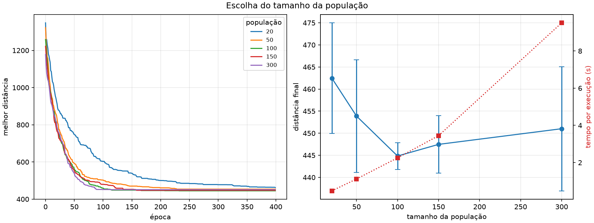
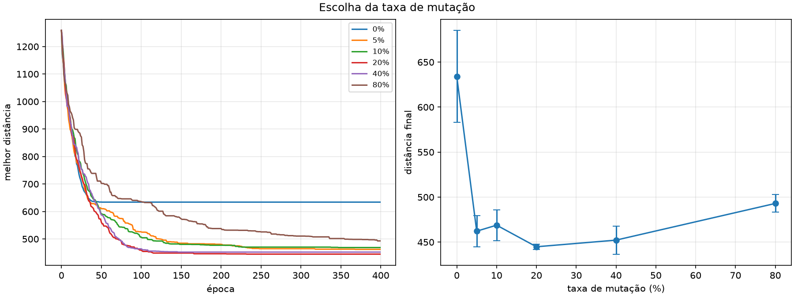
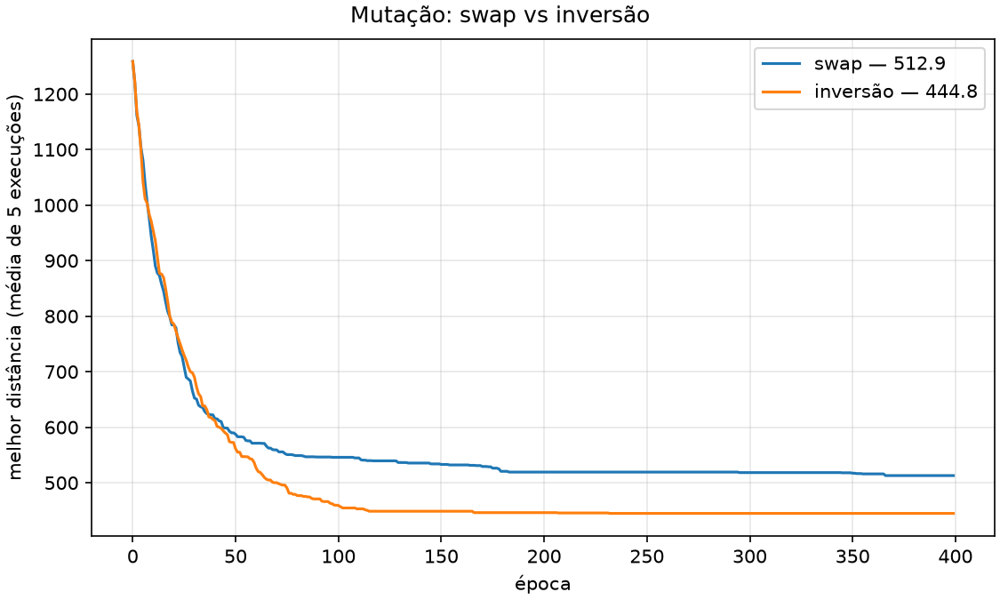
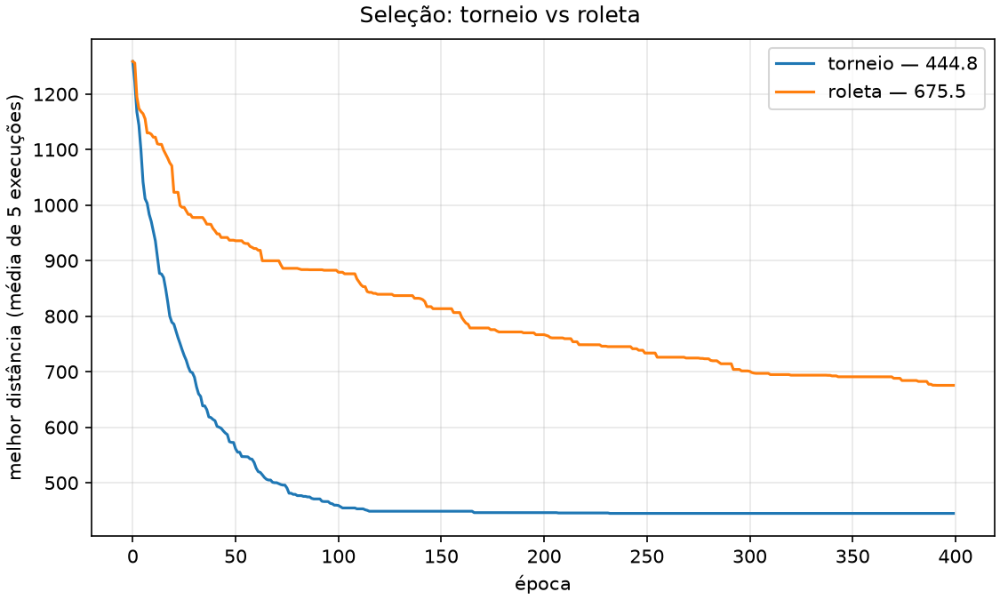
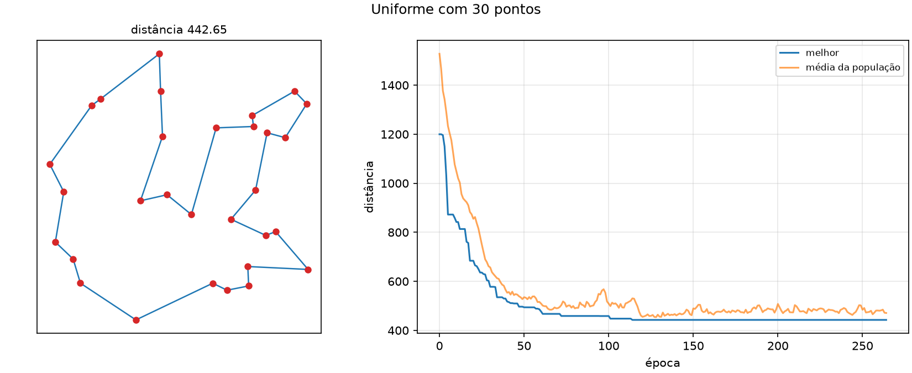
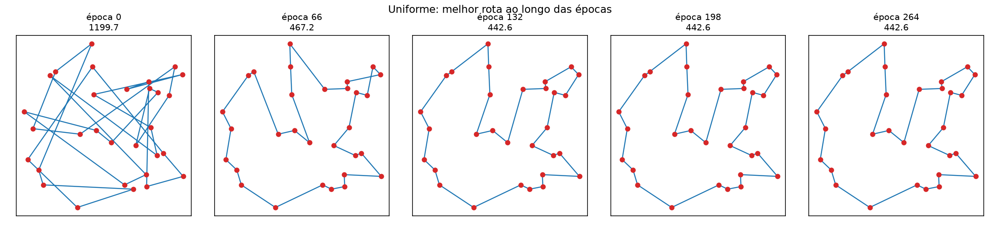
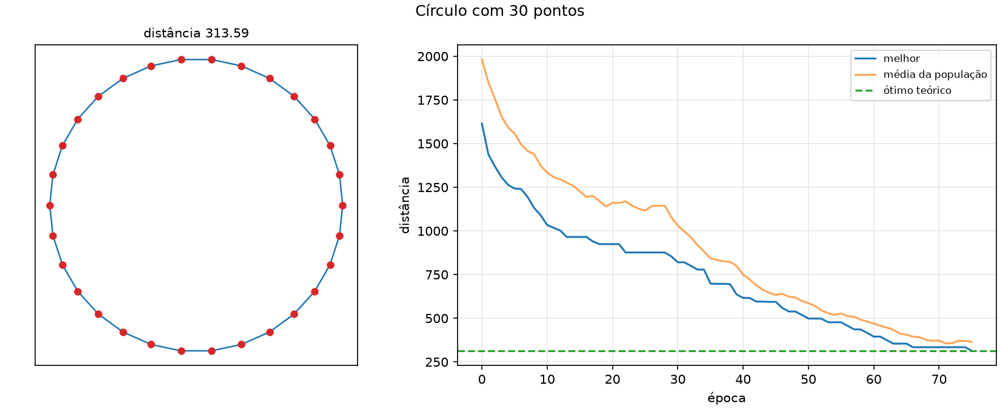
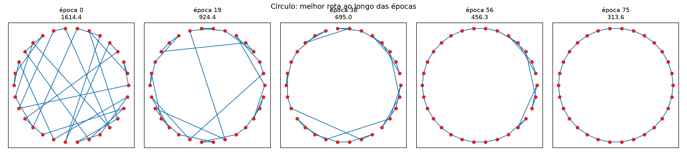
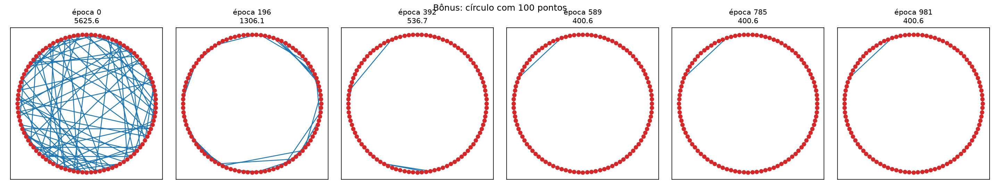

# Algoritmo Genético para o Problema do Caixeiro Viajante

**Disciplina:** Sistemas Inteligentes e Aprendizado de Máquina
**Autor:** Ravi Monreal Nogueira Dal Fabbro

## O problema

Dado um conjunto de pontos em duas dimensões, encontrar um caminho cíclico que passe por
todos eles exatamente uma vez e volte ao ponto de partida, minimizando a distância
euclidiana total percorrida.

Foram avaliados os dois cenários pedidos:

- pontos distribuídos uniformemente dentro de um quadrado;
- pontos igualmente espaçados sobre uma circunferência, usado como benchmark por ter
  solução ótima conhecida.

No cenário circular o melhor caminho possível é percorrer o contorno, e seu comprimento é
`n · 2R · sen(π/n)`, o perímetro do polígono regular de n lados. Ter esse valor exato
permite medir em porcentagem o quanto o algoritmo se aproximou do ideal, em vez de apenas
afirmar que encontrou um caminho curto.

## Como executar

Preparando o ambiente:

```
py -m venv .venv
.venv/Scripts/pip.exe install numpy matplotlib
```

Os dois cenários do enunciado:

```
.venv/Scripts/python.exe main.py uniforme
.venv/Scripts/python.exe main.py circular
```

Os experimentos de parametrização e o teste com muitos pontos:

```
.venv/Scripts/python.exe experimentos.py populacao
.venv/Scripts/python.exe experimentos.py mutacao
.venv/Scripts/python.exe experimentos.py operadores
.venv/Scripts/python.exe experimentos.py selecao
.venv/Scripts/python.exe experimentos.py bonus
```

Sem argumento, cada programa roda todos os seus casos em sequência. Todas as figuras são
salvas na pasta `figuras/`.

## Organização do código

| Arquivo | Conteúdo |
|---|---|
| `pontos.py` | geração dos dois cenários, matriz de distâncias e ótimo teórico do círculo |
| `operadores.py` | representação, aptidão, seleção, cruzamento e mutação |
| `ga.py` | laço evolutivo e critérios de parada |
| `visual.py` | gráficos da rota, da convergência e animação por época |
| `main.py` | execução dos dois cenários do enunciado |
| `experimentos.py` | comparações de parâmetros e teste com quantidade alta de pontos |

## Metodologia dos experimentos

Um algoritmo genético é estocástico: duas execuções com os mesmos parâmetros dão
resultados diferentes. Por isso toda comparação de parâmetros foi feita rodando cinco
vezes com sementes diferentes e reportando média e desvio padrão. O desvio é tão
importante quanto a média, porque indica se a configuração é confiável ou se o resultado
dependeu de sorte.

Nos experimentos de comparação, a parada por estagnação foi desativada igualando a
paciência ao limite de épocas. Isso garante que todas as variantes recebam o mesmo
orçamento de 400 épocas — se uma parasse antes da outra, estaríamos comparando resultados
obtidos com esforços diferentes.

---

## 1. População e critério de parada

### População

Testamos populações de 20, 50, 100, 150 e 300 indivíduos num cenário de 30 pontos,
medindo tanto o resultado final quanto o tempo gasto.

| População | Distância final | Desvio | Tempo |
|---|---|---|---|
| 20 | 462,45 | ±12,54 | 0,48 s |
| 50 | 453,88 | ±12,76 | 1,12 s |
| **100** | **444,84** | **±3,02** | **2,25 s** |
| 150 | 447,47 | ±6,51 | 3,45 s |
| 300 | 451,02 | ±14,06 | 9,51 s |

O melhor resultado veio com 100 indivíduos, e foi esse o valor adotado. A curva tem um
fundo claro em vez de melhorar indefinidamente: populações pequenas demais não têm
variedade genética suficiente para o cruzamento combinar, e populações grandes demais
consomem muito tempo por época sem compensar, já que o número de épocas é o mesmo para
todos os casos.

É exatamente o custo descrito em aula: o total de soluções exploradas é o número de épocas
multiplicado pela população. Aumentar a população não é de graça — com 300 indivíduos o
tempo subiu mais de quatro vezes em relação a 100, e o resultado piorou. Vale registrar
que esse ponto ótimo depende do orçamento de épocas: com mais épocas disponíveis,
populações maiores teriam espaço para refinar melhor, então 100 não é um número universal.

A população de 100 também foi a mais consistente, com desvio padrão de 3,02 contra 12 a 14
nos extremos — as cinco execuções terminaram praticamente no mesmo valor.

Além das médias, acompanhamos a diversidade genética pelas duas curvas de cada execução: a
do melhor indivíduo e a da média da população. Enquanto as duas ficam separadas, ainda há
variedade a ser explorada; quando se encontram, a população virou cópias do mesmo caminho
e a busca travou.



### Critério de parada

Combinamos os três critérios apresentados em aula, e o algoritmo para no primeiro que
acontecer:

1. **Limite de épocas** — garante que o programa sempre termina.
2. **Estagnação** — se o melhor resultado não melhora por 150 épocas seguidas, paramos.
   Isso evita gastar centenas de épocas numa população que já parou de evoluir.
3. **Meta de qualidade** — no cenário circular conhecemos a resposta certa pela fórmula do
   polígono, então paramos ao chegar a 0,1% dela.

O programa registra qual dos três disparou, e os dois cenários pararam por motivos
diferentes: o circular atingiu a meta, e o uniforme parou por estagnação. No cenário
uniforme a meta não existe, porque não há como saber o caminho ótimo de antemão —
encontrar a resposta exata do caixeiro viajante é um problema sem solução eficiente
conhecida.

---

## 2. Taxa de mutação

Usamos 20% de chance de mutação por filho gerado. Testamos as taxas de 0%, 5%, 10%, 20%,
40% e 80%:

| Taxa | Distância final | Desvio |
|---|---|---|
| 0% | ~633 | alto |
| 5% | 462,15 | ±17,31 |
| 10% | 468,82 | ±17,02 |
| **20%** | **444,84** | **±3,02** |
| 40% | 452,22 | ±15,57 |
| 80% | 492,97 | ±9,79 |

O resultado forma uma curva em U, exatamente como a aula prevê. Sem mutação nenhuma o
algoritmo trava: a curva fica reta a partir da época 45, porque o cruzamento só recombina
o material genético que já existe na população, e quando todos os indivíduos ficam
parecidos não há mais nada novo para combinar. O resultado fica 42% pior. No outro
extremo, com 80% a mutação destrói caminhos bons mais rápido do que a seleção consegue
preservá-los.

O que mais pesou na escolha foi o desvio padrão. Em 20% ele é 3,02, enquanto nas taxas
vizinhas passa de 17. Isso significa que as cinco execuções com 20% terminaram
praticamente no mesmo lugar, enquanto as de 5% variaram bastante. A taxa escolhida não é
só melhor na média, ela é reproduzível.

Uma limitação a registrar: a diferença entre 5% e 20% tem barras de erro que quase se
encostam, então é consistente mas não é uma diferença gritante. O que é inquestionável são
os extremos.



### Qual operador de mutação

Comparamos dois tipos de mutação. A troca simples (*swap*) escolhe duas cidades e inverte
a posição delas. A inversão pega um trecho do caminho e vira ele de trás para frente.

| Operador | Distância final |
|---|---|
| swap | 512,9 |
| **inversão** | **444,8** |

A inversão venceu com folga — a troca simples é 15% pior. A explicação é geométrica: num
ciclo, o que custa distância são as ligações entre cidades vizinhas no caminho. Trocar
duas cidades de lugar mexe em até quatro ligações de uma vez, o que costuma estragar uma
solução boa. Inverter um trecho mantém todo o miolo ligado do mesmo jeito, só que no
sentido contrário — apenas as duas ligações das pontas mudam. É uma alteração pequena e
controlada, capaz de desfazer cruzamentos no mapa sem bagunçar o resto do caminho.



---

## 3. Representação do gene e cruzamento

### Representação

Cada indivíduo é um vetor com os números das cidades na ordem em que são visitadas. Por
exemplo, `[3, 0, 2, 1]` significa ir da cidade 3 para a 0, depois para a 2, depois para a
1 e voltar para a 3. O retorno ao ponto de partida fica implícito: não é preciso repetir a
primeira cidade no fim, porque todo caminho é fechado por definição.

A escolha central é que o vetor é sempre uma **permutação** — cada cidade aparece
exatamente uma vez. Com isso, a regra do problema ("visitar todas as cidades uma única vez
e voltar ao início") fica embutida no próprio formato do indivíduo. Qualquer indivíduo
válido já é uma solução válida. Não precisamos de nenhuma penalidade na função objetivo
para punir caminhos que repetem cidade ou deixam alguma de fora, porque esses caminhos
simplesmente não podem ser representados.

Isso responde diretamente ao que a aula aponta: as restrições do problema precisam estar
ou na função objetivo ou na genética dos indivíduos. Nós escolhemos colocar na genética.

### Cruzamento

Essa escolha tem uma consequência direta: os cruzamentos mais simples não funcionam. Pegar
a primeira metade de um pai e a segunda metade do outro geraria um filho com cidades
repetidas e cidades faltando. O mesmo vale para o cruzamento uniforme, que sorteia cada
posição de um pai ou do outro. Como decidimos que a restrição mora na representação, o
cruzamento é obrigado a preservá-la.

Por isso usamos o **Ordered Crossover**. Ele funciona assim:

1. Sorteamos dois pontos de corte e copiamos esse trecho do primeiro pai direto para o
   filho.
2. Percorremos o segundo pai do começo ao fim, pulando as cidades que já entraram.
3. Preenchemos os espaços vazios com as cidades restantes, mantendo a ordem em que elas
   aparecem no segundo pai.

Exemplo com `Pai A = [0 1 2 3 4 5 6 7]`, `Pai B = [3 7 1 6 0 5 2 4]` e cortes em 2 e 5:

- trecho herdado de A: `[2 3 4]`
- cidades de B que ainda faltam, na ordem de B: `[7 1 6 0 5]`
- filho: `[7 1 | 2 3 4 | 6 0 5]`

O filho herda duas coisas: um pedaço contínuo do caminho do primeiro pai e a ordem de
visita do segundo. E o resultado é sempre uma permutação válida.

Usamos dois pontos de corte em vez de um. Com um corte só, o começo do caminho sempre
viria de um pai e o fim sempre do outro, criando um favorecimento pela posição dentro do
cromossomo. Com dois cortes sorteados, qualquer pedaço do caminho pode ser herdado.

---

## 4. Função de aptidão

A função que o algoritmo otimiza é o comprimento total do ciclo: a soma das distâncias
entre cidades vizinhas no caminho, mais a distância de volta da última para a primeira.
É a definição direta do problema, sem termos extras, porque — como explicado acima — não
precisamos penalizar nada: todo indivíduo já é um caminho válido.

As distâncias são euclidianas e calculamos todas uma única vez no início, guardando numa
tabela de todas as cidades contra todas. O algoritmo mede o comprimento de um caminho
dezenas de milhares de vezes ao longo da execução, então recalcular raízes quadradas toda
vez seria o gargalo do programa. Com a tabela pronta, medir um caminho vira apenas uma
soma de valores já calculados.

Como o objetivo é **minimizar** a distância, mas a ideia de aptidão é "quanto maior,
melhor", definimos a aptidão como o inverso da distância. Isso não é formalidade: a
seleção por roleta precisa de um número proporcional à qualidade para sortear, e distância
não serve, porque ali menor é melhor. O inverso resolve.

### Qual seleção

Testamos as duas formas. No torneio, sorteamos três indivíduos e o de menor distância
vence a vaga. Na roleta, cada indivíduo tem chance proporcional à sua aptidão.

| Seleção | Distância final | Desvio |
|---|---|---|
| **torneio** | **444,84** | **±3,02** |
| roleta | 675,46 | ±105,61 |

O torneio ganhou de longe, e a roleta foi mal por um motivo que vale explicar. Num
problema de caixeiro viajante, caminhos diferentes têm comprimentos parecidos em ordem de
grandeza — um caminho ruim não é mil vezes pior que um bom, é cerca de duas vezes pior.
Ao inverter esses valores, as probabilidades ficam todas muito próximas umas das outras, e
a roleta acaba sorteando quase por igual. Ela quase não distingue bons de ruins, e a
evolução fica lenta. O torneio não tem esse problema porque compara apenas quem é melhor,
sem se importar com a diferença numérica.

O desvio padrão reforça o ponto: ±105,61 na roleta contra ±3,02 no torneio. Além de pior,
a roleta é imprevisível — cada execução termina num lugar diferente.

Além do torneio, mantemos os dois melhores indivíduos de cada geração intactos na geração
seguinte, sem cruzamento nem mutação. Isso resolve uma fraqueza conhecida do torneio: se
por azar o melhor indivíduo não for sorteado em nenhum torneio daquela época, ele se
perde. Com essa garantia, o melhor resultado nunca piora de uma geração para outra, e a
curva de convergência é monotônica.



---

## Resultados — cenário uniforme

30 pontos sorteados uniformemente num quadrado de 100 × 100.

| | |
|---|---|
| Distância final | 442,65 |
| Épocas | 265 |
| Tempo | 1,47 s |
| Motivo da parada | estagnação (150 épocas sem ganho) |
| Ótimo conhecido | não existe |

A curva do melhor indivíduo desce em degraus, não em rampa: longos platôs seguidos de
quedas bruscas. É o comportamento típico de um algoritmo genético — a população fica presa
numa configuração até que um cruzamento ou mutação afortunado destrave uma melhora, e o
elitismo propaga essa melhora rapidamente. Esses platôs são justamente o motivo de existir
o critério de parada por estagnação.

A curva da média da população permaneceu acima da curva do melhor até o fim da execução,
sem colapsar sobre ela. Isso indica que a população continuou diversa, sem convergência
prematura.





## Resultados — cenário circular

30 pontos igualmente espaçados sobre uma circunferência de raio 50. Os pontos são
embaralhados antes de serem entregues ao algoritmo, de propósito: se fossem entregues na
ordem do contorno, a solução ótima seria a própria ordem dos índices e o benchmark não
teria valor.

| | |
|---|---|
| Distância final | 313,59 |
| Ótimo teórico | 313,59 |
| Acima do ótimo | 0,00% |
| Épocas | 76 |
| Motivo da parada | meta atingida |

O algoritmo reconstruiu o polígono regular partindo de permutações aleatórias, sem
qualquer informação sobre a geometria do problema. A curva do melhor indivíduo encosta na
linha do ótimo teórico, o que confirma visualmente que a solução encontrada é a ideal.

O cenário circular converge muito mais rápido que o uniforme — 76 épocas contra 265. Isso
era esperado: no círculo existe uma estrutura geométrica forte, em que cada cidade tem
dois vizinhos naturais, e a mutação por inversão é especialmente eficaz em descobri-la.
No cenário uniforme não há regularidade a ser explorada, e o algoritmo precisa de mais
tempo para encontrar um arranjo bom.





---

## Bônus — quantidade alta de pontos

Círculo com 100 pontos e população de 300 indivíduos.

| | |
|---|---|
| Distância final | 400,57 |
| Ótimo teórico | 314,11 |
| Acima do ótimo | 27,53% |
| Épocas até a última melhora | 582 |
| Épocas totais | 982 |
| Motivo da parada | estagnação (400 épocas sem ganho) |
| Tempo por época | 18,4 ms |
| **Tempo até convergir** | **≈ 10,7 s** |
| Tempo total de execução | 18,1 s |

Vale separar os dois tempos. A execução inteira levou 18,1 segundos, mas a última melhora
aconteceu na época 582 — os 400 ciclos seguintes foram o algoritmo confirmando a
estagnação antes de parar. O tempo efetivo até a convergência foi portanto de cerca de
10,7 segundos.

Com 100 pontos o algoritmo já não alcança o ótimo. O espaço de busca cresce de forma
fatorial com o número de cidades, e a mesma estratégia que resolvia 30 pontos
perfeitamente fica 27,53% acima do ideal aqui.

A rota encontrada é visualmente informativa: o contorno do círculo está quase perfeito,
com uma corda cortando a região superior esquerda. Esse é um mínimo local clássico — para
corrigi-lo seria necessária uma sequência específica de mutações que a seleção não
favorece individualmente, porque cada passo intermediário piora a solução antes de
melhorá-la.

A curva de convergência mostra a causa. A partir da época 400 as linhas do melhor
indivíduo e da média da população praticamente se sobrepõem, diferente do que acontece nos
cenários de 30 pontos, onde elas permanecem separadas até o fim. Isso indica que a
população perdeu diversidade: os indivíduos viraram variações mínimas do mesmo caminho, o
cruzamento parou de gerar novidade e só a mutação continuou produzindo variação. Com 100
cidades, uma população de 300 indivíduos cobre uma fatia pequena demais do espaço de
busca para sustentar a diversidade até o fim.



As soluções em épocas intermediárias estão registradas em `figuras/bonus_epocas.png`,
mostrando a evolução do emaranhado inicial até o círculo quase fechado.

---

## Limitações

- A rota encontrada no cenário uniforme ainda apresenta arestas que se cruzam. Num
  problema euclidiano, a rota ótima nunca tem cruzamentos — se duas arestas se cruzam,
  trocar suas pontas produz um caminho mais curto pela desigualdade triangular. A presença
  de cruzamentos é portanto prova de que a solução é um mínimo local, não o ótimo global.
- O teste com 100 pontos terminou 27,5% acima do ótimo conhecido.
- Os experimentos de parametrização usaram um único conjunto de pontos, variando apenas a
  semente do algoritmo. Um estudo mais rigoroso variaria também os conjuntos de pontos.

Nenhuma dessas limitações contraria o que o método se propõe a fazer. Um algoritmo
genético é uma busca local baseada em heurística: ele não garante a melhor resposta
possível, garante uma boa resposta em tempo viável, num problema cujo espaço de busca
torna a busca exaustiva impraticável.
